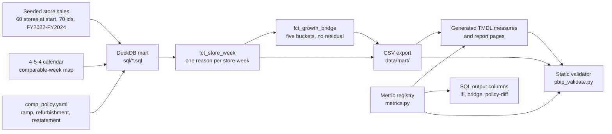

# likeforlike

[](https://github.com/sharmaaman8588-hue/likeforlike/actions/workflows/ci.yml)


likeforlike computes like-for-like (comparable-store) sales for a 60-store homeware chain (60 stores at the start, 70 store ids over the period) on a 4-5-4 fiscal calendar. Every store-week is classified as `comp` or given exactly one non-comp reason, the prior-year comparison is restated after the 53-week year, and total growth is split into five buckets that add up to it with no residual. The reference implementation is a DuckDB mart; the same measures are generated into a Power BI project (PBIP with TMDL files and a three-page report) that a static validator checks for consistent references against the mart's CSV export and the metric registry. All data is synthetic and seeded, with known patterns injected so that the tests can check the numbers are recovered.

## The problem

A retail BI team publishes like-for-like growth every week and the board watches it. Three things leak into the number if they are handled carelessly:

- New stores open at half of mature sales and ramp up for about twelve weeks, so a store opened last year makes this year look better than the stores that were already trading.
- Refurbishment closures, relocations and permanent closures change which stores are in the comparison.
- A 53-week fiscal year shifts every week by one. The year after it, "week 47" is the week before Christmas rather than Christmas week, so December swings by several points unless last year's weeks are restated.

The result is a healthy-looking LFL while comparable stores barely grew. This project makes each rule explicit, tests each one against data where the true answer is known, and shows how far each rule moves the headline.

## How it works



1. `likeforlike.synth` writes stores, refurbishment closures and weekly sales. Sales are store size times a seasonal index anchored to calendar dates (the week containing Black Friday x1.6, the week containing 25 December x1.8, weeks ending 1-14 January x0.8, a mild summer lift), a true +2.0% yearly growth for trading stores, an opening ramp from 50% to 100% over 12 weeks, and +/-3% uniform noise.
2. `likeforlike.calendar` builds the fiscal calendar and the comparable-week map. In the year after a 53-week year, week `w` compares with last year's week `w + 1`; otherwise `w` with `w`. Weeks without a partner are recorded as unmatched.
3. The four steps in `sql/` build `dim_store`, `dim_fiscal_week`, `fct_store_week` and `fct_growth_bridge`. `comp_policy.yaml` supplies the ramp length and which rules are on. Each store-week gets the first reason that applies, in this order: `no_prior_year`, `extra_week`, `refurbishment`, `closed_store`, `new_store`, otherwise `comp`.
4. The bridge puts both the TY and the LY sales of each store-week in the bucket of its reason, and adds last year's unmatched week (week 1 of FY2023, after the restatement) as `extra_week` with zero TY sales. Each bucket's contribution is (TY - LY) / total LY, so the buckets sum to total growth by construction.
5. `metrics.py` holds each measure's name, SQL column, SQL expression and DAX expression. The CLI queries and the TMDL measures are both generated from it.
6. `likeforlike.pbip` writes `powerbi/` and `likeforlike.pbip_validate` re-reads the written files without using the generator: it checks every `'Table'[Column]` in the measures, every relationship and every visual field against the CSV headers, and compares each measure's name and DAX text to the registry. It checks that references resolve and the text matches; it does not evaluate DAX or open the report in Power BI. The waterfall is sorted comp, new store, closed store, refurbishment, extra week through the `bucket_order` column, and relies on Power BI's built-in total bar.

## Quick start

Python 3.11 or newer.

```bash
python -m venv .venv && . .venv/bin/activate
pip install -e ".[dev]"

likeforlike generate --seed 7 --out data/raw     # synthetic stores and weekly sales
likeforlike build                                # mart -> data/mart/*.csv, PBIP -> powerbi/
likeforlike lfl --year 2024 --by month           # LFL by fiscal month
likeforlike bridge --year 2024                   # growth bridge
likeforlike policy-diff                          # how ramp and restatement move LFL
likeforlike validate-pbip                        # static check of the Power BI project
pytest -q
```

`data/mart/` is committed so the Power BI project opens with data. To open it, use Power BI Desktop with the PBIP (Power BI Project) format enabled, open `powerbi/LikeForLike.pbip`, and set the `DataFolder` parameter (Transform data, Manage parameters) to the folder that holds the four CSVs. `likeforlike build --data-folder "D:\data\mart"` writes a different default into the model. The project has not been opened in Power BI Desktop here; see the design decisions for what is and is not verified.

`policy-diff --no-ramp` and `policy-diff --no-restate` each show one variant; without flags both are shown.

## Example output

Real output from `likeforlike lfl --year 2024 --by month` on the seeded data (the true like-for-like growth injected into trading stores is 2.0%):

```text
      FY2024 like-for-like by fiscal month
┏━━━━━━━┳━━━━━━━━━━━━━━━┳━━━━━━━━━━━━━━━┳━━━━━━━┓
┃ Month ┃ Comp sales TY ┃ Comp sales LY ┃ LFL % ┃
┡━━━━━━━╇━━━━━━━━━━━━━━━╇━━━━━━━━━━━━━━━╇━━━━━━━┩
│ Feb   │    12,122,240 │    11,897,177 │ 1.89% │
│ Mar   │    14,754,366 │    14,470,910 │ 1.96% │
│ Apr   │    11,791,445 │    11,583,007 │ 1.80% │
│ May   │    12,164,442 │    11,854,825 │ 2.61% │
│ Jun   │    15,299,018 │    14,944,015 │ 2.38% │
│ Jul   │    12,383,194 │    12,139,974 │ 2.00% │
│ Aug   │    12,001,488 │    11,754,126 │ 2.10% │
│ Sep   │    14,643,741 │    14,360,222 │ 1.97% │
│ Oct   │    12,058,935 │    11,790,581 │ 2.28% │
│ Nov   │    14,546,517 │    14,267,988 │ 1.95% │
│ Dec   │    18,305,527 │    17,944,775 │ 2.01% │
│ Jan   │    12,353,748 │    12,124,449 │ 1.89% │
└───────┴───────────────┴───────────────┴───────┘
```

`likeforlike bridge --year 2024`. Contributions are in points of FY2023 sales, so `comp` (1.935) is smaller than the LFL of 2.07% because comp store-weeks are not all of last year's sales:

```text
 FY2024 growth bridge (pp)
┏━━━━━━━━━━━━━━━━┳━━━━━━━━━┓
┃ Bucket         ┃      pp ┃
┡━━━━━━━━━━━━━━━━╇━━━━━━━━━┩
│ comp           │  +1.935 │
│ new_store      │ +12.614 │
│ closed_store   │  -1.793 │
│ refurbishment  │  -0.114 │
│ extra_week     │  -1.790 │
├────────────────┼─────────┤
│ sum of buckets │ +10.852 │
│ total growth   │ +10.852 │
│ residual       │  < 1e-9 │
└────────────────┴─────────┘
```

`likeforlike policy-diff` shows what each rule is worth. Without the ramp exclusion, stores that opened last year are compared against their half-empty opening weeks and LFL rises by 0.75 points. Without the restatement, fiscal December compares Christmas week with an ordinary week and falls to -1.60%:

```text
                FY2024 LFL under different comp policies
┏━━━━━━━━━━━━━━━━━━━┳━━━━━━━━━━┳━━━━━━━━━━━━━━┳━━━━━━━━━┳━━━━━━━━━━━━━━┓
┃ Policy            ┃ Year LFL ┃ vs base (pp) ┃ Dec LFL ┃ vs base (pp) ┃
┡━━━━━━━━━━━━━━━━━━━╇━━━━━━━━━━╇━━━━━━━━━━━━━━╇━━━━━━━━━╇━━━━━━━━━━━━━━┩
│ baseline          │    2.07% │        +0.00 │   2.01% │        +0.00 │
│ no ramp exclusion │    2.82% │        +0.75 │   2.40% │        +0.39 │
│ no restatement    │    2.05% │        -0.02 │  -1.60% │        -3.61 │
└───────────────────┴──────────┴──────────────┴─────────┴──────────────┘
```

## Design decisions

- **One reason per store-week, decided by a fixed order.** `comp_policy.yaml` lists the order and the loader rejects any other. A store-week that is both inside a refurbishment and inside the ramp window is reported as `refurbishment`, so the bridge buckets partition the sales and reasons can be counted. The cost is that a reason does not tell you everything that applied.
- **A store-week touching a closure on any day is out, even if the store traded six days of it.** That follows the written rule and keeps the test simple (a week is closed or it is not). It excludes some sales that were comparable. The generator starts closures on arbitrary days so partly closed weeks are exercised.
- **Restatement is a fixed 364-day shift, not a holiday match.** After a 53-week year, week `w` is compared with last year's week `w + 1`, which keeps weekday and fiscal-week alignment and fixes Christmas and the January weeks. Thanksgiving moves by a calendar date from year to year, so in FY2024 Black Friday falls in week 43 while last year's falls in the week that restates to week 42. Weekly LFL around Thanksgiving is therefore noisy, although fiscal November as a whole contains both.
- **The unmatched last-year week joins the first fiscal month of the bridge.** FY2023 week 1 has no FY2024 partner. Putting its sales in the bridge as `extra_week` in month 1 keeps every month and the year additive, at the price that month 1's total growth carries a five-week base.
- **SQL is the tested reference; DAX is checked statically.** Power BI cannot run in CI, so the tests compute every number in DuckDB (and again in plain Python for the classification), and the validator checks that the model references real columns and that each measure's DAX text equals the registry. It does not evaluate DAX, so a semantic error in a registry expression would pass.
- **Measures come from one registry.** SQL column names, DAX text and TMDL measure names cannot drift apart without a validator failure, at the cost that the registry is a single point of failure for all three. The pp measures use `REMOVEFILTERS` on the bucket column so each bucket is divided by total last-year sales.

## Testing

```bash
pytest -q
```

The tests run offline in about two seconds and check concrete values. The committed data CSVs are not compared byte for byte, because random streams are not guaranteed to be identical between numpy releases; `pyproject.toml` bounds numpy, duckdb and pandas to their current major versions, and the example output below comes from those versions with seed 7. They cover the calendar (FY2022 to FY2024 boundaries, 52/53 weeks, 4-5-4 months, every year from 1995 to 2059 starts on a Sunday and ends on the Saturday nearest 31 January, the restated map and its unmatched weeks), the generator (determinism, counts of openings, closures and refurbishments, relocation distance, ramp, date-anchored holidays, the +2% growth), the mart (the SQL classification equals an independent Python implementation for the baseline and for both policy variants; refurbishment weeks and their comparable weeks are non-comp; the relocated store stays `new_store` until its comparable week leaves the ramp; the bridge sums to total growth to 1e-9 for every fiscal month and year; every TY and LY sales value is in exactly one bucket; LFL recovers 2.0% within 0.15 points; the committed CSVs are checked by schema, rules and recovered numbers, and the calendar CSV equals a fresh build), and the Power BI project (the committed project validates, and fixtures with a renamed CSV column, a changed measure, a missing measure, a bad relationship, an undeclared `queryGroup` or a bad visual field fail with a message that names the problem).

## Project layout

```text
comp_policy.yaml            comp rules: ramp length, restatement, precedence
sql/                        DuckDB reference mart (dim_store, dim_fiscal_week, fct_store_week, fct_growth_bridge)
src/likeforlike/
  calendar.py               4-5-4 calendar and comparable-week map
  synth.py                  seeded synthetic stores and weekly sales
  policy.py                 loads comp_policy.yaml
  mart.py                   builds the mart in DuckDB and exports CSV
  schema.py                 exported table and column layout, relationships
  metrics.py                metric registry: name, SQL column, SQL expression, DAX
  analysis.py               LFL by period, bridge, policy what-ifs
  pbip.py                   writes the PBIP project (TMDL and report.json)
  pbip_validate.py          independent static validator
  cli.py                    typer command line
data/mart/                  exported mart CSVs (committed, under 1 MB)
powerbi/                    LikeForLike.pbip, SemanticModel (TMDL), Report
tests/                      pytest suite
```

## License

MIT. See `LICENSE`.

## Maintainer

Currently maintained by **Aman Sharma**, Project Manager | Electrical Infrastructure | Power Systems & T&D. The project is grounded in electrical and electronics engineering and experience coordinating complex infrastructure and cross-functional programs.

For project inquiries or feedback: [sharma.aman8588@gmail.com](mailto:sharma.aman8588@gmail.com).

The original project is hosted at [sharmaaman8588-hue/likeforlike](https://github.com/sharmaaman8588-hue/likeforlike).